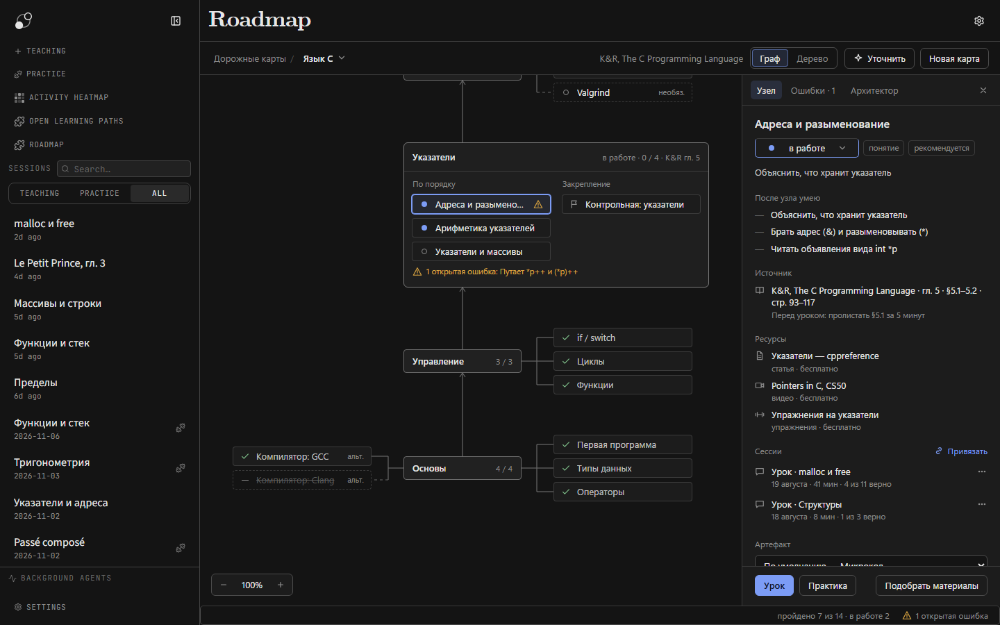
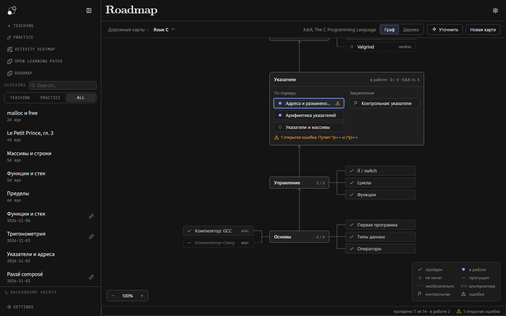

# Roadmap — LearnHarness plugin

Learning roadmaps drawn like [roadmap.sh](https://roadmap.sh): the first module at
the bottom, the goal at the top, sub-topics branching off the main line. A
persistent **Architect** builds the roadmap from your Knowledge Graph and the
roadmap.sh topic files. Books and web pages only add resources to existing nodes.
Every node opens native **Lesson** and **Practice** sessions that report progress
and mistakes back to the map.



Roadmap is a LearnHarness Community plugin (`apiVersion: 1`, id `roadmap-learnharness`,
LearnHarness 0.6.0 or newer). The interface is available in English and
Russian (Settings → Roadmap → Interface language; *Auto* follows the system).

> Roadmap started as a fork of [Learning Paths](https://github.com/kerr-mwv/learning-path-plugin)
> by **kerr-mwv** (AGPL-3.0). The pedagogical framework, the Architect, the error
> ledger and the session bridge come from that project; Roadmap replaces the
> interface and extends the data model. See [Credits](#credits).

## What it looks like

- **Tree view** (default). Modules are frames stacked from the first module at
  the bottom to the goal at the top. Inside each frame, nodes sit in columns by
  dependency depth, and arrows run from each prerequisite to the node that needs
  it. Interchangeable choices (GCC *or* Clang) are bracketed and marked `alt.`;
  optional nodes are dashed. Drag to pan, Ctrl + wheel or the zoom control to zoom.
- **Graph view.** Only the nodes and their prerequisite arrows, in columns by
  dependency depth, with no module frames. Pan and zoom work the same way.
- **Node panel** (Node / Errors / Architect tabs): status, type, the goal,
  *After this node I can…*, the source anchor with a pre-reading pointer, typed
  resources (book, article, video, course, docs, exercises; free or not), the
  nodes it builds on, linked sessions with focused minutes and correct answers,
  and the recommended artifact with the reason for it. **Open** goes to the node's
  latest linked chat, or starts a Lesson if it has none, so every node opens as a chat.
- **Status line**: required nodes done, nodes in progress, open errors.



Statuses are *not started*, *in progress*, *consolidated* and *skipped*. Nothing
is gated: any node can be opened at any time. Optional nodes are never counted
in progress, and a group of alternatives counts once.

## How it works

1. **Create a roadmap.** Tell the Architect what you want to be able to do in the
   end. It builds the structure in this order:
   - **Your Knowledge Graph.** The Architect reads it through `ctx.learning.graph()`
     and never writes to it. Topics you already studied become optional nodes,
     marked as a short review.
   - **The developer-roadmap topic files** from
     [nilbuild/developer-roadmap](https://github.com/nilbuild/developer-roadmap),
     read at one pinned commit. They give the modules, the nodes and the tagged
     resources of each topic. Resources are copied as written, with their links.
   - **Books and web pages, last.** They only add resources and context to nodes
     that already exist. They never create topics, nodes or roadmap structure.
     Drop books and notes (PDF, Markdown, text) onto the Architect panel or attach
     them with *Book or notes*.

   If GitHub cannot be reached, the Architect says so and stops. It does not
   use another source for the structure.
   **Build from my graph.** On an empty roadmap, *Build from my graph* opens the
   Architect with a request to build from your graph. The button stays disabled
   until the graph has at least one topic, so study some material first.
2. **Study a node.** *Lesson* or *Practice* creates a native LearnHarness session,
   stages a brief (goal, outcomes, source anchor, earlier nodes to weave in, open
   errors, the artifact) and opens it. Linked sessions get `roadmap_*` tools to
   read the brief and record progress, errors and suggestions.
3. **Mistakes travel forward.** Errors are logged by cognitive root cause
   (misconception, confusing concepts, prerequisite gap, procedural slip, missed
   cue), never as grades. Open errors follow into later sessions until resolved.
   When a topic really is not sticking, a session may suggest a small repair
   node; you accept, discuss or dismiss it. The roadmap never changes silently.
4. **A roadmap from any session.** When the prober or teacher has assessed you
   and your goal is wider than one session, it offers a roadmap once (never in
   sessions launched from a roadmap or in research sessions; if you say no, it
   stops). On agreement it hands the Architect the full diagnostic dossier —
   goal, background, every check with your answer and its verdict, strengths,
   gaps, misconceptions by root cause, preferences, constraints, sources, open
   questions and key quotes. A card in the chat offers *Build* / *Not now*.
   *Build* opens Roadmap and the Architect builds from the dossier without
   asking again: mastered material becomes optional or a short review, gaps get
   bridge nodes, misconceptions get contrast nodes and land in the Error Ledger
   as open entries. The source session is not linked to the roadmap.
5. **Refine.** *Refine* reopens the roadmap's Architect conversation; *Find
   resources* on a node asks it for typed resources for that node.

There is deliberately **no scheduling and no gamification**: no hours, streaks,
points or deadlines.

## Your graph and progress

- **Matched nodes are optional.** When a planned node covers a topic in your
  graph, it is optional and marked as a short review. The Architect never marks
  a node consolidated, matched or not.
- **Studied elsewhere.** The node panel shows the study evidence for a node whose
  title matches a topic name in your Knowledge Graph. The match compares the
  node's title with the topic name, ignoring case and punctuation. It only
  suggests a status. Nothing changes until you confirm it.
- **Next up.** The roadmap lists up to three nodes to study next. It ranks them
  by prerequisites, open errors and your Knowledge Graph mastery. Nothing is
  gated: any node can still be opened.

The Knowledge Graph is read-only for Roadmap. You confirm every status change.

## Research

Settings → Roadmap → Research. Research adds resources and context only. The
Architect no longer uses web search to create structure. Every channel can be
switched off.

| Channel | Default | What it does |
| --- | --- | --- |
| Research sessions in LearnHarness | On (hybrid) | *Research in a session* opens a teaching chat that researches the topic with the search engine set in LearnHarness and hands the report to the Architect. The search key stays inside LearnHarness. |
| Open catalogs | On (hybrid) | Open Library, Google Books, OpenAlex, arXiv, Wikipedia and reading public pages. No key. |
| Deep research via Claude Code | Off | Runs the Claude Code CLI (the one LearnHarness uses for its claude-code provider) with **only** web search and page reading, in an empty temporary folder. Slow and uses your Claude limits. |
| My own search key | Off | Web search with your Tavily or Brave key. Plugins cannot use the system password store, so the key is a plain file in `data/secrets/` — use a key with a spending limit. |

The **Offline** preset switches every channel off. The Architect then builds from
your graph and the topic files only, and adds no web resources.

*Deep research* in the composer asks for confirmation (it can take long and use
many tokens) and applies to the next message. Page reading refuses local and
private network addresses. Reports from research sessions and Claude Code are
kept as research notes (listed in settings) that the Architect reads.

## Install

### From a release (no build tools)

1. Download `roadmap-<version>.zip` from the latest release.
2. In LearnHarness open **Settings → Community plugins** and copy the plugins
   directory path.
3. Unzip there so that `<plugins-directory>/roadmap-learnharness/dist/manifest.json` exists.
4. Press **Refresh**, enable **Roadmap**, and restart LearnHarness.

To update, replace `roadmap-learnharness/dist/` and keep `roadmap-learnharness/data/` (your roadmaps).
The plugin id changed from `roadmap`; on first start it copies `learning-paths.json` and
`architect.json` (this fork's format) from `<plugins-directory>/roadmap/data/` if the new data folder
has no roadmap yet. The old
folder is never changed.

### From source

The plugin API types are not on npm. In LearnHarness open **Settings → Community
plugins** and use **Download authoring skill**, then extract the downloaded
`learnharness-plugins/` folder into this repo (it is git-ignored).

```sh
git clone https://github.com/808arc/roadmap-learnharness.git
cd roadmap-learnharness
npm run sdk      # copies learnharness-plugins/types into .sdk/
npm ci
npm run install:local -- "<plugins-directory>"
```

`install:local` builds `dist/` and copies it into `<plugins-directory>/roadmap-learnharness/dist/`.
It never touches `data/`, so your roadmaps are kept.

For a rebuild-and-install loop on macOS, run `./plugin-sync.sh` from the repo. It runs
`npm ci`, builds, and installs into `~/Library/Application Support/LearnHarness/data/plugins/roadmap-learnharness/`.

- With an existing install it stops. `--force` deletes the installed folder first,
  **including `data/` (your roadmaps)**, so back them up before using it.
- `--restart` quits LearnHarness gracefully and opens it again after the install.
- The install path is macOS only. On Windows or Linux use `install:local` with your
  plugins directory, and set `LEARNHARNESS_APP` to the app's executable for
  `npm run restart:learnharness`.

`npm run restart:learnharness` restarts LearnHarness on its own. It asks the app to quit
(never force-closed) and waits up to 30 seconds; if the app has not closed by then, it stops and
does not start it again. It finds the app on macOS only; elsewhere set `LEARNHARNESS_APP`.
`node scripts/restart-learnharness.mjs` without `--restart` only prints its usage.

### Coming from Learning Paths

On first start Roadmap **copies** your Learning Paths data (paths, settings,
uploaded sources and Architect conversations) into its own folder. The original
plugin's data is never modified, and the import runs only once. After checking
that everything is there you can disable Learning Paths.

## Settings

Settings → Roadmap:

| Setting | Default |
| --- | --- |
| Interface language | Auto (system language) |
| Architect writes in | Auto (the language you write in) |
| Default view | Tree |
| Show optional nodes | On |
| Artifact defaults per node type | Framework recommendation |
| Architect model | Follow the host's strong model, or choose one |
| Research | Hybrid: research sessions + open catalogs |
| Offer roadmaps from sessions | On (off removes both the rule and the tool) |
| Roadmaps | Delete a roadmap (sessions and the Knowledge Graph are never touched) |

## Data

Everything lives in the plugin's own data folder (`<plugins>/roadmap-learnharness/data/`):
`roadmaps/` (one file per roadmap, named by a hash of its id), `roadmaps-index.json`, `settings.json`,
`architect-model.json`, `sources/`, `research/` (research notes), `research-chats.json`,
`declined-proposals.json` (roadmap offers you declined), `secrets/search-key.json` (only if you save
your own search key), `logs/architect-runs.jsonl` (see Logs), and a `.gitignore` the plugin writes so that
`secrets/`, `logs/` and `*.tmp` stay out of a Git-versioned data folder. LearnHarness reserves
`agents/`, `tasks/` and `usage.jsonl` here; Roadmap never reads or writes them. An older
`learning-paths.json` is read once to write the roadmap files; it stays in the data folder as
`learning-paths.json.migrated`.

Records are versioned and written atomically; corrupt or newer files are refused rather than
overwritten. Roadmap never deletes native chats or Knowledge Graph records.

[docs/data.md](docs/data.md) lists every file and whether Git keeps it;
[docs/integrations.md](docs/integrations.md) covers the related plugins.

## Logs

Architect runs are logged to `data/logs/architect-runs.jsonl`, capped at 512 KB. Each
line holds timings and counts only: model, provider and token counts per run,
whether your graph was attached and how many topics and chains it had, each
research call with its outcome, and a short reason for rejected calls (URLs
removed). Your goal, notes, graph text and the model's answers are never logged.

## Development

```sh
npm ci
npm run sdk         # copies the LearnHarness plugin types into .sdk/
npm test            # Node test runner, no model or network
npm run typecheck   # needs the SDK types in .sdk/
npm run build       # bundles into dist/
npm run check       # typecheck, build, test and version check
```

The tests mount the real views against recorded host primitives and an
in-memory backend; the backend tests run the real `activate` against an
in-process host.

### CI and releases

- `ci.yml` builds and tests every push and pull request.
- `close-merged-issues.yml` closes an issue when a commit pushed to `main` ends
  its subject with `(#N)`.
- `release.yml` runs on a `v*` tag: it checks the tag matches the version, builds,
  and attaches `roadmap-<version>.zip` (containing `roadmap-learnharness/dist/`)
  to a GitHub release.

To release: `node scripts/release.mjs patch` (sets `manifest.json` and
`package.json`), commit, then tag `v<version>` and push the tag.

## Credits

- [Learning Paths](https://github.com/kerr-mwv/learning-path-plugin) by
  **kerr-mwv** — the original plugin this project is forked from: the
  pedagogical framework ([FRAMEWORK.md](./FRAMEWORK.md)), the Path Architect,
  the error ledger, pivots and the native session bridge.
- [roadmap.sh](https://roadmap.sh) — the visual reference for the roadmap.
- [LearnHarness](https://github.com/amosblomqvist/learnharness) by Amos Blomqvist.

## License

[AGPL-3.0-only](./LICENSE), the same license as the original project.
